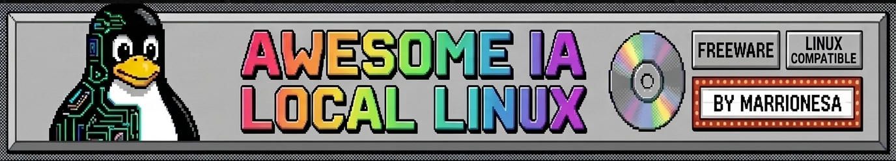

# Awesome IA Local en Linux

Una colección seleccionada de herramientas, modelos, runtimes, aplicaciones y recursos para ejecutar, desarrollar y asegurar sistemas de IA locales en Linux.

[Cómo contribuir](CONTRIBUTING.md) · [Catálogo web](website/README.md) · [Reportar un enlace roto](.github/ISSUE_TEMPLATE/report-broken-link.yml)

---

## Introducción

Ejecutar un LLM en tu propia máquina ya no es lo difícil. Lo difícil es saber **qué herramienta elegir, qué licencia tiene y si seguirá manteniéndose dentro de seis meses**. Para eso existe este listado: cada entrada fue verificada contra su fuente oficial el **24 de noviembre de 2026** (proyecto activo o de referencia, licencia declarada, documentación real y soporte Linux documentado), y el conjunto cubre el recorrido completo de la IA local: runtimes, serving, modelos abiertos, escritorio, agentes y MCP, RAG, voz, imagen y vídeo, monitorización, seguridad y desarrollo.

Nada entra por popularidad. Los proyectos archivados se etiquetan como tales en vez de desaparecer en silencio; lo descartado queda registrado con su motivo; y cada entrada declara su licencia antes de que adoptes nada. El resultado es un catálogo **bilingüe (ES/EN)**, mantenido de forma independiente y publicado bajo **CC0-1.0**: cópialo, reúsalo y remézclalo sin pedir permiso.

## Filosofía del proyecto

| Principio                  | Qué significa                                                                                                                                                                                                    |
| -------------------------- | ---------------------------------------------------------------------------------------------------------------------------------------------------------------------------------------------------------------- |
| Verificar antes que listar | Ninguna entrada entra por popularidad ni por relleno: se comprueba que el proyecto existe, que su licencia es identificable y que su documentación oficial es real. Lo que no se pudo verificar, no está.        |
| Local es local             | Aquí solo entra lo que ejecuta o gestiona modelos en tu máquina o tu red. Los servicios cloud se mencionan solo como contraste, nunca como recomendación.                                                        |
| Linux primero              | Todo lo listado funciona en Linux de forma nativa o con soporte documentado; las notas de compatibilidad (CUDA, ROCm, Vulkan, CPU) proceden de la documentación oficial de cada proyecto, nunca de suposiciones. |
| Etiquetar, no borrar       | Un proyecto archivado que sigue siendo la referencia de su nicho no desaparece del listado: se marca como archivado y, si existe, se señala su sucesor. La historia del ecosistema también es información.       |
| Licencia en cada entrada   | Saber qué puedes hacer con una herramienta antes de adoptarla es parte del valor del listado: cada entrada declara su licencia SPDX o su condición de software propietario.                                      |
| Bilingüe por diseño        | El README en inglés contiene exactamente la misma selección y se mantiene sincronizado; ninguna de las dos versiones es ciudadana de segunda.                                                                    |
| Independiente              | Proyecto de curación mantenido por [Mario R.](https://github.com/marrionesa), sin afiliación con ningún sistema operativo, fabricante ni empresa.                                                                |

## Para quién es este listado

Este listado es para quien quiere **ejecutar LLM en local** por privacidad, coste o soberanía de datos; para quien **desarrolla** aplicaciones con IA y necesita servidores de inferencia, APIs compatibles con OpenAI o bibliotecas de su lenguaje; para quien **administra** estaciones o servidores Linux con GPU y quiere monitorizar, asegurar y automatizar; y para quien trabaja con **voz, imagen o vídeo** sin depender de servicios externos.

## Cómo elegir por dónde empezar

| Si quieres…                                            | Empieza por                                      |
| ------------------------------------------------------ | ------------------------------------------------ |
| Chatear con modelos locales hoy mismo, sin complicarte | `Ollama` o `Jan`                                 |
| Servir modelos con una API compatible con OpenAI       | `Ollama`, `LocalAI` o `llama-cpp-python`         |
| Máximo rendimiento en servidor con GPU                 | `vLLM` o `SGLang`                                |
| Probar modelos en CPU, sin GPU dedicada                | `llama.cpp` o `llamafile`                        |
| Transcribir o generar voz en local                     | `whisper.cpp` y `Piper`                          |
| Generar imágenes o vídeo                               | `ComfyUI` o `diffusers`                          |
| Montar un asistente o agente con tus documentos        | `MCP servers` y la sección `RAG`                 |
| Saber qué licencia tiene cada cosa antes de adoptarla  | Cada entrada indica su licencia entre paréntesis |

## A. Runtimes de LLM locales

Motores que ejecutan modelos de lenguaje en tu hardware: desde una sola CLI hasta plataformas multi-modelo.

- [Ollama](https://github.com/ollama/ollama) - La forma más rápida de arrancar con modelos locales: CLI sencilla, API propia compatible con OpenAI, gestión de modelos incluida. (MIT) `[CUDA] [ROCm] [Vulkan] [CPU]`.
- [llama.cpp](https://github.com/ggml-org/llama.cpp) - Inferencia LLM en C/C++ sin dependencias pesadas; el motor GGUF de referencia que alimentan decenas de interfaces. (MIT) `[CUDA] [ROCm] [Vulkan] [CPU]`.
- [vLLM](https://github.com/vllm-project/vllm) - Motor de inferencia y serving de alto rendimiento para GPU, con PagedAttention y lotes continuos; estándar de facto en servidores. (Apache-2.0) `[CUDA] [ROCm] [CPU]`.
- [SGLang](https://github.com/sgl-project/sglang) - Serving de LLM y multimodales con ejecución estructurada y caché de prefijos muy agresiva; alternativa directa a vLLM. (Apache-2.0) `[CUDA] [ROCm] [CPU]`.
- [LocalAI](https://github.com/mudler/LocalAI) - Sustituto local de la API de OpenAI que sirve texto, voz, imagen y multimodales desde tu propia máquina. (MIT) `[CUDA] [CPU]`.
- [llamafile](https://github.com/Mozilla-Ocho/llamafile) - Empaqueta modelo y runtime en un único ejecutable multiplataforma; ejecuta LLM con un doble clic, también desde un pendrive. (Apache-2.0) `[CPU] [CUDA]`.
- [MLC LLM](https://github.com/mlc-ai/mlc-llm) - Motor de despliegue universal basado en compilación ML; compila modelos para GPU, CPU y navegadores. (Apache-2.0) `[CUDA] [Vulkan] [ROCm] [CPU]`.
- [gemma.cpp](https://github.com/google/gemma.cpp) - Motor de inferencia ligero y autónomo en C++ para la familia Gemma; útil para estudiar y modificar el runtime. (Apache-2.0) `[CPU]`.
- [mistral.rs](https://github.com/EricLBuehler/mistral.rs) - Inferencia LLM en Rust con API compatible con OpenAI y soporte de cuantización; opción sólida si prefieres Rust. (MIT) `[CUDA] [CPU]`.
## B. Servidores y APIs de inferencia

Capa de servicio: servidores dedicados, pasarelas y enlaces de lenguaje que exponen los modelos vía HTTP.

- [LM Studio](https://lmstudio.ai/) - Aplicación de escritorio para descubrir, descargar y servir modelos locales con servidor API compatible con OpenAI. (Propietario gratuito) `[CUDA] [Vulkan] [CPU]` · [Descarga Linux](https://lmstudio.ai/download)
- [NVIDIA Triton Inference Server](https://github.com/triton-inference-server/server) - Servidor de inferencia de producción para múltiples backends y frameworks, con lotes dinámicos y métricas. (BSD-3-Clause) `[CUDA] [CPU]`.
- [TensorRT-LLM](https://github.com/NVIDIA/TensorRT-LLM) - Biblioteca de NVIDIA para optimizar y servir LLM sobre GPUs NVIDIA con kernels TensorRT. (Apache-2.0) `[CUDA]`.
- [OpenVINO](https://github.com/openvinotoolkit/openvino) - Toolkit de Intel para optimizar y desplegar inferencia en CPU, GPU integrada y NPU Intel. (Apache-2.0) `[CPU] [GPU Intel]`.
- [LiteLLM](https://github.com/BerriAI/litellm) - Pasarela unificada a más de cien APIs de LLM con formato OpenAI, gestión de claves, presupuesto y router; núcleo en Rust. (Apache-2.0 con directorio enterprise comercial)
- [llama-cpp-python](https://github.com/abetlen/llama-cpp-python) - Enlaces Python para llama.cpp con servidor web compatible con OpenAI; el pegamento clásico de muchos proyectos locales. (MIT) `[CUDA] [Vulkan] [CPU]`.
> Nota: [Text Generation Inference](https://github.com/huggingface/text-generation-inference) (Apache-2.0), el servidor de inferencia de Hugging Face, fue **archivado por sus mantenedores** en 2026; sigue disponible como referencia histórica pero recomendamos evaluar los runtimes activos de la sección A.

## C. Modelos abiertos

Familias de modelos con pesos públicos. Distingue proveedor, repositorio oficial y condiciones de uso; el repositorio canónico de cada familia enlaza a las descargas.

- [Qwen3](https://github.com/QwenLM/Qwen3) - Familia de modelos abiertos de Alibaba Cloud, de 0.6B a 235B, con variantes de razonamiento; repositorio oficial con report técnico. (Apache-2.0 en los pesos) · [Organización en Hugging Face](https://huggingface.co/QwenLM)
- [Llama](https://github.com/meta-llama/llama-models) - Familia de modelos abiertos de Meta; el repositorio centraliza utilidades y enlaces oficiales de descarga. (Licencia comunitaria Llama, con condiciones propias)
- [Gemma](https://github.com/google-deepmind/gemma) - Familia de modelos abiertos de Google DeepMind con licencia de términos de Gemma; repositorio oficial de la familia. (Términos Gemma)
- [Mistral AI](https://huggingface.co/mistralai) - Organización oficial de descarga de los modelos de Mistral (Mistral Small, Ministral, DevStral…); el código de referencia está en [mistral-src](https://github.com/mistralai/mistral-src), archivado en 2026. (Apache-2.0 en la mayoría de pesos)
- [DeepSeek-V3](https://github.com/deepseek-ai/DeepSeek-V3) - Modelo MoE abierto de DeepSeek (671B totales, ~37B activos); pesos y report técnico oficiales. (MIT)
- [DeepSeek-R1](https://github.com/deepseek-ai/DeepSeek-R1) - Modelo de razonamiento abierto de DeepSeek derivado de la línea V3; pesos oficiales y comparativas. (MIT)
- [gpt-oss](https://github.com/openai/gpt-oss) - Primeros modelos de pesos abiertos de OpenAI (120B y 20B), optimizados para ejecutarse en hardware de consumidor. (Apache-2.0)
- [Phi Cookbook](https://github.com/microsoft/PhiCookBook) - Guías y ejemplos oficiales para la familia de modelos pequeños Phi de Microsoft. (MIT)
- [SmolLM / SmolVLM](https://github.com/huggingface/smollm) - Familia de modelos pequeños de Hugging Face pensados para portátiles y equipos modestos, con recetas de entrenamiento. (Apache-2.0)

## D. GPU, hardware y aceleración

Documentación de fabricantes, bibliotecas de tensores, formatos de pesos y herramientas de cuantización: lo que decide si un modelo cabe y va rápido.

- [CUDA Toolkit — documentación oficial](https://docs.nvidia.com/cuda/) - Guías de instalación y desarrollo de NVIDIA para Linux; punto de partida para cualquier stack con GPU NVIDIA.
- [ROCm (TheRock)](https://github.com/ROCm/TheRock) - Desarrollo actual de la plataforma de cómputo de AMD para GPUs; el antiguo repositorio central [ROCm/ROCm](https://github.com/ROCm/ROCm) está archivado. (MIT) · [Documentación oficial](https://rocm.docs.amd.com/)
- [Vulkan-Docs](https://github.com/KhronosGroup/Vulkan-Docs) - Especificación oficial de Vulkan, el backend GPU multi-fabricante que usan llama.cpp y otros runtimes para GPUs AMD/Intel/NVIDIA sin CUDA ni ROCm. (CC-BY-4.0)
- [GGML](https://github.com/ggml-org/ggml) - Biblioteca de tensores en C en la que se basa llama.cpp; documentación interna del formato y ejecución en CPU/GPU. (MIT)
- [Especificación GGUF](https://github.com/ggml-org/ggml/blob/master/docs/gguf.md) - Documento oficial del formato de ficheros GGUF (pesos cuantizados + metadatos), el estándar de facto de la IA local.
- [safetensors](https://github.com/huggingface/safetensors) - Formato de almacenamiento de tensores seguro y rápido, estándar en Hugging Face; evita ejecución arbitraria al cargar pickles. (Apache-2.0)
- [ExLlamaV3](https://github.com/turboderp-org/exllamav3) - Motor de inferencia y cuantización optimizado para GPUs de consumidor; sucesor activo de ExLlamaV2. (MIT) `[CUDA]`.
- [LLM Compressor](https://github.com/vllm-project/llm-compressor) - Suite de compresión y cuantización del ecosistema vLLM (FP8, INT8, GPTQ, sparse) para servir modelos comprimidos. (Apache-2.0)
- [GPTQModel](https://github.com/ModelCloud/GPTQModel) - Toolkit de cuantización GPTQ con aceleración por hardware y soporte de despliegue en vLLM/SGLang. (Apache-2.0) `[CUDA]`.
- [bitsandbytes](https://github.com/bitsandbytes-foundation/bitsandbytes) - Cuantización k-bit accesible para PyTorch (8-bit, 4-bit); pieza habitual del fine-tuning en GPU de consumidor. (MIT) `[CUDA]`.
> Nota: [IPEX-LLM](https://github.com/intel/ipex-llm) (Apache-2.0), la aceleración de LLM para Intel, fue **archivado** en 2026; para hardware Intel reciente, OpenVINO (sección B) es la vía mantenida.

## E. IA de escritorio en Linux

Aplicaciones gráficas para conversar, gestionar modelos e integrar IA en el escritorio Linux.

- [Jan](https://github.com/menloresearch/jan) - Asistente de IA de código abierto que funciona 100 % sin conexión, con gestión de modelos y servidor API local. (Apache-2.0)
- [GPT4All](https://github.com/nomic-ai/gpt4all) - Cliente de escritorio para ejecutar LLM locales en equipos modestos; proyecto emblemático cuya actividad de desarrollo se ha reducido en 2026. (MIT)
- [AnythingLLM](https://github.com/Mintplex-Labs/anything-llm) - Aplicación todo en uno para chatear con tus documentos: agents, RAG integrado y multiusuario, en escritorio o servidor. (MIT)
- [Open WebUI](https://github.com/open-webui/open-webui) - Interfaz web autohospedada muy completa para Ollama y APIs compatibles con OpenAI, con usuarios, RAG y herramientas. (Licencia propia con excepciones de marca para grandes despliegues)
- [LibreChat](https://github.com/danny-avila/LibreChat) - Cliente chat multi-modelo autohospedado (local y remoto) con agentes, búsqueda y MCP. (MIT)
- [Alpaca](https://github.com/jeffser/Alpaca) - Cliente de IA nativo para GNOME (GTK), con soporte Ollama y otros proveedores locales; la opción más integrada en el escritorio Linux. (GPL-3.0)
- [KoboldCpp](https://github.com/LostRuins/koboldcpp) - Ejecutable único basado en llama.cpp para correr modelos GGUF con la interfaz KoboldAI; popular en narrativa interactiva. (AGPL-3.0) `[CUDA] [Vulkan] [CPU]`.
## F. Agentes de IA y automatización

Agentes de código, protocolos de herramientas (MCP) y frameworks de orquestación que funcionan contra modelos locales.

- [Aider](https://github.com/Aider-AI/aider) - Programación en pareja con IA en tu terminal: edita el repositorio con diffs y hace commits con sentido. (Apache-2.0)
- [Continue](https://github.com/continuedev/continue) - Agente de código open source como extensión de IDE y CLI, conectable a modelos locales vía Ollama o LM Studio. (Apache-2.0)
- [Cline](https://github.com/cline/cline) - Agente autónomo de desarrollo como SDK, extensión de IDE y CLI; trabaja contra APIs locales o remotas. (Apache-2.0)
- [OpenHands](https://github.com/All-Hands-AI/OpenHands) - Plataforma de agentes de desarrollo con sandbox propio: escribe código, ejecuta comandos y navega. (MIT)
- [Open Interpreter](https://github.com/openinterpreter/open-interpreter) - Agente que ejecuta código en tu máquina desde el lenguaje natural, compatible con modelos locales. (Apache-2.0)
- [Goose](https://github.com/block/goose) - Agente extensible de código abierto de Block para automatización en el escritorio y el terminal, con MCP. (Apache-2.0)
- [MCP — servidores de referencia](https://github.com/modelcontextprotocol/servers) - Servidores oficiales de referencia del Model Context Protocol, el estándar para conectar agentes con herramientas y datos; el proyecto está migrando de MIT a Apache-2.0. (MIT → Apache-2.0)
- [Langflow](https://github.com/langflow-ai/langflow) - Constructor visual de agentes y workflows en Python, desplegable en local y conectado a Ollama y otros backends. (MIT)
- [Pydantic AI](https://github.com/pydantic/pydantic-ai) - Framework de agentes en Python con validación de tipos e inyección de dependencias; ideal para apps serias sobre modelos locales. (MIT)
- [smolagents](https://github.com/huggingface/smolagents) - Biblioteca minimalista de agentes de Hugging Face que razonan escribiendo código; ligera y fácil de auditar. (Apache-2.0)
- [LangGraph](https://github.com/langchain-ai/langgraph) - Construcción de agentes con estado y flujos con ciclos, de la familia LangChain; base de muchos sistemas multiagente. (MIT)

## G. RAG y sistemas de conocimiento

Bases vectoriales, frameworks de indexación y pipelines de recuperación para construir segundas cerebros locales.

- [Qdrant](https://github.com/qdrant/qdrant) - Base de datos vectorial de alto rendimiento escrita en Rust, con despliegue en contenedor o embebida. (Apache-2.0)
- [Milvus](https://github.com/milvus-io/milvus) - Base vectorial cloud-native para escala grande, con índices variados y operaciones distribuidas. (Apache-2.0)
- [Weaviate](https://github.com/weaviate/weaviate) - Base de datos vectorial con búsqueda híbrida y módulos de vectorización; licencia dual según componente. (BSD-3-Clause / Weaviate)
- [Chroma](https://github.com/chroma-core/chroma) - Base vectorial embebida pensada para desarrolladores: arranca en segundos y escala cuando hace falta. (Apache-2.0)
- [pgvector](https://github.com/pgvector/pgvector) - Búsqueda de similitud vectorial como extensión de PostgreSQL; reutiliza la infraestructura que ya conoces. (Licencia PostgreSQL)
- [Haystack](https://github.com/deepset-ai/haystack) - Framework de orquestación para construir aplicaciones de RAG y agentes con pipelines declarativos. (Apache-2.0)
- [LlamaIndex](https://github.com/run-llama/llama_index) - Framework de ingesta, indexación y consulta de documentos; el punto de partida habitual para RAG con modelos locales. (MIT)
- [Khoj](https://github.com/khoj-ai/khoj) - Segundo cerebro autohospedable: busca en tus documentos y en la web desde una interfaz web o el terminal. (AGPL-3.0)
- [Onyx](https://github.com/onyx-dot-app/onyx) - Plataforma de chat con IA conectada a las fuentes de una empresa (conectores, RAG, agentes); autohospedada. (Apache-2.0 con excepciones enterprise)
- [RAGFlow](https://github.com/infiniflow/ragflow) - Motor RAG con comprensión profunda de documentos y citación trazable, para despliegues serios en local. (Apache-2.0)
- [Docling](https://github.com/docling-project/docling) - Convierte PDF, Office e imágenes en datos estructurados listos para RAG; parsing local y de alta calidad. (MIT)
- [Marker](https://github.com/VikParuchuri/marker) - Convierte PDF a Markdown y JSON con alta precisión, respetando tablas, fórmulas y diseño de página; ideal para alimentar RAG con documentos reales. (Apache-2.0) `[CUDA] [CPU]`.
## H. Voz

Reconocimiento, síntesis, diarización y asistentes de voz completos que funcionan sin nube.

- [Whisper](https://github.com/openai/whisper) - Modelo de reconocimiento de voz de OpenAI, robusto en muchos idiomas; la referencia para STT local. (MIT) `[CPU] [CUDA]`.
- [whisper.cpp](https://github.com/ggml-org/whisper.cpp) - Port en C/C++ de Whisper con cuantización y BINDINGS variados; corre en CPU modestas e incluso en la Raspberry Pi. (MIT) `[CPU] [CUDA] [Vulkan]`.
- [Faster-Whisper](https://github.com/SYSTRAN/faster-whisper) - Reimplementación de Whisper sobre CTranslate2: hasta 4× más rápido con menos memoria. (MIT) `[CPU] [CUDA]`.
- [Piper 1](https://github.com/OHF-voice/piper1-gpl) - Motor de TTS neuronal rápido y local, mantenimiento activo de la comunidad (sucesor del [Piper original](https://github.com/rhasspy/piper), archivado). (GPL-3.0) `[CPU]`.
- [Kokoro](https://github.com/hexgrad/kokoro) - Modelo TTS sorprendentemente competente para su tamaño (82M), ideal para voz local de baja latencia. (Apache-2.0) `[CPU]`.
- [Coqui TTS (mantenimiento comunitario)](https://github.com/idiap/coqui-ai-TTS) - Toolkit de texto a voz de la línea Coqui, mantenido por la comunidad tras el cierre de la empresa (el [repositorio original](https://github.com/coqui-ai/TTS) lleva años sin actividad). (MPL-2.0)
- [F5-TTS](https://github.com/SWivid/F5-TTS) - TTS de clonación de voz con generación fluida y código oficial; fuerte en chino e inglés. (MIT) `[CUDA] [CPU]`.
- [Chatterbox](https://github.com/resemble-ai/chatterbox) - TTS open source de Resemble AI con control de emoción y clonación, con modelos de referencia publicados. (MIT) `[CUDA]`.
- [Silero VAD](https://github.com/snakers4/silero-vad) - Detector de actividad de voz preentrenado, precisión enterprise y latencia mínima; pieza clave de pipelines de voz. (MIT) `[CPU]`.
- [pyannote-audio](https://github.com/pyannote/pyannote-audio) - Diarización y segmentación de locutores estado del arte, útil para transcripciones con múltiples hablantes. (MIT) `[CUDA] [CPU]`.
- [sherpa-onnx](https://github.com/k2-fsa/sherpa-onnx) - STT, TTS, diarización y realce de voz offline sobre ONNX, con binarios para Linux, Android y embebidos. (Apache-2.0) `[CPU]`.
- [Wyoming](https://github.com/rhasspy/wyoming) - Protocolo punto a punto para asistentes de voz modulares del ecosistema Rhasspy (el satélite remoto [wyoming-satellite](https://github.com/rhasspy/wyoming-satellite) está archivado pero sigue siendo la referencia del patrón). (MIT)
- [Home Assistant](https://github.com/home-assistant/core) - Plataforma de domótica con asistencia de voz 100 % local (Wake word, STT, TTS y LLM en tu red); el integrador de todo lo anterior. (Apache-2.0)

## I. Imagen, vídeo e IA creativa

Generación y edición local de imagen y vídeo: interfaces, bibliotecas y modelos.

- [ComfyUI](https://github.com/comfyanonymous/ComfyUI) - Interfaz nodular y backend para difusión; el estándar para pipelines reproducibles de imagen y vídeo. (GPL-3.0) `[CUDA] [ROCm] [CPU]`.
- [ComfyUI-Manager](https://github.com/ltdrdata/ComfyUI-Manager) - Extensión imprescindible para instalar y gestionar nodos y modelos de ComfyUI sin romper nada. (GPL-3.0)
- [Stable Diffusion WebUI](https://github.com/AUTOMATIC1111/stable-diffusion-webui) - La interfaz web clásica de Stable Diffusion; desarrollo muy ralentizado en 2025–2026, pero sigue siendo la más documentada. (AGPL-3.0) `[CUDA]`.
- [InvokeAI](https://github.com/invoke-ai/InvokeAI) - Motor creativo profesional con lienzo, inpaint y organización de assets; orientado a flujos de trabajo de arte. (Apache-2.0) `[CUDA] [ROCm] [CPU]`.
- [Fooocus](https://github.com/lllyasviel/Fooocus) - Generación de imagen simplificada al estilo Midjourney; el proyecto no recibe mantenimiento activo desde 2025. (GPL-3.0) `[CUDA]`.
- [FLUX.1](https://github.com/black-forest-labs/flux) - Repositorio oficial de la familia de modelos FLUX.1 de Black Forest Labs (pesos y demos). (Apache-2.0 en FLUX.1-schnell) `[CUDA]`.
- [diffusers](https://github.com/huggingface/diffusers) - Biblioteca de referencia de Hugging Face para difusión: imagen, vídeo y audio con PyTorch; base de casi todo lo anterior. (Apache-2.0) `[CUDA] [ROCm] [CPU]`.
- [stable-diffusion.cpp](https://github.com/leejet/stable-diffusion.cpp) - Inferencia de difusión en C/C++ puro con GGUF: genera imágenes en CPU y en GPUs variadas vía Vulkan/CUDA. (MIT) `[CUDA] [Vulkan] [CPU]`.
- [Krita AI Diffusion](https://github.com/Acly/krita-ai-diffusion) - Plugin de difusión integrado en Krita con inpaint, outpaint y control de capas; flujo de trabajo de ilustración real. (GPL-3.0) `[CUDA]`.
- [Upscayl](https://github.com/upscayl/upscayl) - Escalado de imágenes con IA, libre y nativo en Linux (Electron + modelos real-esrgan). (AGPL-3.0) `[Vulkan] [CPU]`.
- [Wan 2.2](https://github.com/Wan-Video/Wan2.2) - Familia de modelos abiertos de generación de vídeo de Alibaba; pesos y código oficiales. (Apache-2.0) `[CUDA]`.
- [HunyuanVideo](https://github.com/Tencent-Hunyuan/HunyuanVideo) - Modelo de generación de vídeo de Tencent con código y pesos abiertos; la licencia comunitaria excluye la UE, Reino Unido y Corea del Sur. (Licencia comunitaria Hunyuan, con restricciones territoriales) `[CUDA]`.
- [LTX-Video](https://github.com/Lightricks/LTX-Video) - Modelo de vídeo en tiempo real de Lightricks, rápido para su tamaño y con ecosistema ComfyUI. (Apache-2.0) `[CUDA]`.
- [FramePack](https://github.com/lllyasviel/FramePack) - Enfoque de FramePack para vídeo diffusion práctico en GPUs de consumidor con memoria limitada. (Apache-2.0) `[CUDA]`.
## J. Monitorización y rendimiento

Observabilidad del hardware y de la inferencia: GPU, VRAM, sistema y benchmarks.

- [nvtop](https://github.com/Syllo/nvtop) - Monitor de procesos GPU estilo `htop` para NVIDIA, AMD, Intel y más; imprescindible para ver VRAM al vuelo. (GPL-3.0)
- [gpustat](https://github.com/wookayin/gpustat) - Resumen de estado de GPUs NVIDIA en una línea, ideal para scripts y paneles. (MIT) `[CUDA]`.
- [btop](https://github.com/aristocratos/btop) - Monitor de recursos del sistema (CPU, memoria, red, discos) con interfaz TUI excelente. (Apache-2.0) `[CPU]`.
- [Mission Center](https://gitlab.com/mission-center-devs/mission-center) - Monitor de sistema gráfico estilo GNOME con soporte de GPU; proyecto canónico en GitLab. (GPL-3.0)
- [lm-evaluation-harness](https://github.com/EleutherAI/lm-evaluation-harness) - Framework de EleutherAI para evaluar LLM en decenas de tareas; la forma seria de comparar modelos en tu hardware. (MIT)

## K. Seguridad, privacidad y hardening

Evaluar, aislar y proteger: desde el red teaming de modelos hasta el sandboxing de la ejecución local.

- [OWASP GenAI — Top 10 para aplicaciones LLM](https://github.com/GenAI-Security-Project/GenAI-LLM-Top10) - El catálogo de riesgos de referencia para apps de LLM (edición 2026); lectura previa obligada antes de exponer nada. (Contenido OWASP, documentación)
- [promptfoo](https://github.com/promptfoo/promptfoo) - Tests, evaluación y red teaming de prompts, agentes y RAG; se integra en CI. (MIT)
- [garak](https://github.com/NVIDIA/garak) - Escáner de vulnerabilidades de LLM de NVIDIA: sondea jailbreaks, fugas y alucinaciones. (Apache-2.0)
- [Purple Llama](https://github.com/meta-llama/PurpleLlama) - Herramientas de Meta para seguridad de LLM (Llama Guard, CyberSecEval); útil para filtrar entradas y salidas de modelos locales. (Licencia comunitaria Llama)
- [Guardrails](https://github.com/guardrails-ai/guardrails) - Validación y corrección de salidas de LLM contra esquemas y reglas. (Apache-2.0)
- [Firejail](https://github.com/netblue30/firejail) - Sandbox SUID para aplicaciones Linux; forma sencilla de aislar herramientas de IA de escritorio de tus datos. (GPL-2.0)
- [Podman](https://github.com/containers/podman) - Contenedores sin demonio y rootless para aislar servidores de inferencia y pipelines RAG. (Apache-2.0)
- [Model Transparency (Sigstore)](https://github.com/sigstore/model-transparency) - Firma y verificación de procedencia de modelos de ML; respuesta open source al riesgo de supply-chain en pesos y checkpoints. (Apache-2.0)

> Nota: [LLM Guard](https://github.com/protectai/llm-guard) (MIT), toolkit de filtrado para LLM, fue **archivado** en 2026; para filtrado activo revisa Guardrails y las herramientas de la lista.

## L. Ecosistema de desarrollo

Bibliotecas y SDK para construir tu propia capa local: Python, Rust, TypeScript y herramientas de fine-tuning.

- [Transformers](https://github.com/huggingface/transformers) - El framework de modelos de Hugging Face: carga, inferencia y entrenamiento de prácticamente cualquier modelo abierto. (Apache-2.0)
- [PEFT](https://github.com/huggingface/peft) - Fine-tuning eficiente en parámetros (LoRA y amigos) para adaptar modelos grandes en hardware pequeño. (Apache-2.0) `[CUDA]`.
- [Candle](https://github.com/huggingface/candle) - Framework minimalista de ML en Rust con inferencia de muchos modelos abiertos; ligero y apto para integrar en apps. (Apache-2.0)
- [Burn](https://github.com/tracel-ai/burn) - Framework de deep learning en Rust con backends GPU/CPU flexibles, pensado para producción. (Apache-2.0)
- [Tauri](https://github.com/tauri-apps/tauri) - Framework para construir apps de escritorio ligeras y seguras; combinación habitual con runtimes locales para crear clientes de IA nativos en Linux. (Apache-2.0/MIT)
- [llm (CLI de Simon Willison)](https://github.com/simonw/llm) - CLI para consultar LLM locales y remotos con un sistema de plugins; el cuchillo suizo para el terminal. (Apache-2.0)
- [Ollama Python](https://github.com/ollama/ollama-python) - Cliente oficial de Python para la API de Ollama. (MIT)
- [AI SDK (Vercel)](https://github.com/vercel/ai) - Toolkit de TypeScript para construir apps con LLM, compatible con proveedores locales vía API OpenAI. (Apache-2.0)
- [Axolotl](https://github.com/axolotl-ai-cloud/axolotl) - Fine-tuning de LLM con recetas YAML; muy usado para ajustar modelos en GPU única. (Apache-2.0) `[CUDA]`.
- [Unsloth](https://github.com/unslothai/unsloth) - Fine-tuning y ejecución local acelerada (hasta 2× más rápido con menos VRAM) para GGUF y modelos de difusión. (Apache-2.0) `[CUDA]`.
- [LLaMA-Factory](https://github.com/hiyouga/LLaMA-Factory) - Fine-tuning unificado de más de 100 modelos LLM y VLM con interfaz web incluida. (Apache-2.0) `[CUDA]`.
## M. Tutoriales y documentación

Documentación oficial y comunidad: la fuente correcta antes que cualquier tutorial de terceros.

- [Documentación de Ollama](https://docs.ollama.com/) - Guías oficiales de instalación en Linux, API, importación de GGUF y ajustes.
- [Documentación de vLLM](https://docs.vllm.ai/) - Despliegue, cuantización, paralelismo y optimización del serving en servidor.
- [Documentación de Hugging Face](https://huggingface.co/docs) - Referencia completa de Transformers, diffusers, PEFT y el resto del ecosistema, con tutoriales paso a paso.
- [r/LocalLLaMA](https://www.reddit.com/r/LocalLLaMA/) - La comunidad más activa sobre IA local: benchmarks reales, guías de hardware y novedades diarias. (Comunidad)
- [Aprende Machine Learning — guía LLM local (ES)](https://www.aprendemachinelearning.com/instalar-un-modelo-de-lenguaje-en-tu-ordenador-llm-local-llama) - Tutorial en español para instalar y usar un LLM local paso a paso. (Blog en español)

## Criterios de inclusión

Un recurso entra en este listado cuando cumple **todas** estas condiciones:

| Criterio                           | Qué exige                                                                                                                        |                                                                                                                                                                                                                                                                                                                                        |
| ---------------------------------- | -------------------------------------------------------------------------------------------------------------------------------- | -------------------------------------------------------------------------------------------------------------------------------------------------------------------------------------------------------------------------------------------------------------------------------------------------------------------------------------- |
| Funciona en Linux                  | De forma nativa o con soporte documentado oficialmente.                                                                          |                                                                                                                                                                                                                                                                                                                                        |
| Fuente oficial verificada          | La URL apunta al repositorio canónico, web o documentación oficial del proyecto.                                                 |                                                                                                                                                                                                                                                                                                                                        |
| Licencia identificable y declarada | Open source con licencia reconocida, o propietario claramente etiquetado como tal.                                               |                                                                                                                                                                                                                                                                                                                                        |
| Actividad o estatus razonable      | En desarrollo activo, o marcado explícitamente como archivado o sin mantenimiento cuando sigue siendo la referencia de su nicho. |                                                                                                                                                                                                                                                                                                                                        |
| Documentación oficial              | Disponible para instalar y usar.                                                                                                 |                                                                                                                                                                                                                                                                                                                                        |
| Valor diferenciado                 | Nada entra «por popularidad»; cada entrada cubre un hueco que las demás no cubren.                                               | Lo que **no** aceptamos: proyectos abandonados sin estatus de referencia, duplicados funcionales, páginas de agregadores sin criterio, servicios cloud sin componente local, y cualquier recurso cuya naturaleza no podamos verificar desde su fuente oficial. El proceso detallado y cómo proponer cambios está en `CONTRIBUTING.md`. |

## Estado de mantenimiento y avisos

La última verificación en bloque de enlaces, licencias y actividad se realizó el **24 de noviembre de 2026**. Los proyectos archivados o sin mantenimiento activo que se mantienen en la lista por su relevancia llevan la anotación correspondiente en su entrada: no desaparecemos la historia, la etiquetamos. Los enlaces se re-comprueban con lychee en CI y con `scripts/validate.js` en local; si encuentras uno roto, abre un reporte con la plantilla «Enlace roto». Las licencias indicadas son las **declaradas por cada proyecto** en su repositorio en la fecha de verificación; para cualquier uso serio, lee el texto de la licencia en la fuente.

## Catálogo web

Este listado tiene su propia **web retro-90s**: un catálogo navegable que se genera siempre desde este README — la única fuente de verdad — y presenta cada recurso como una caja de software con sus estadísticas de GitHub en vivo (estrellas, actividad, archivado). Los datos están siempre frescos: la web carga el README en vivo desde GitHub (con respaldo jsDelivr y snapshot del último build); editar el README y pushear es suficiente para actualizarla. El código fuente vive en `website/` (ver `website/README.md`) y se despliega automáticamente en GitHub Pages por el workflow `deploy-web.yml` en cada push a `main`. Misma licencia **CC0-1.0** y mismas categorías; sin backend y sin cookies: todo se renderiza en tu navegador.

## Otras listas relacionadas

Listas Awesome con solapamiento parcial. Ninguna cubre el mismo nicho con el mismo criterio (Linux + verificación de licencia + estado de mantenimiento), pero todas son de utilidad:

- [awesome-local-llms](https://github.com/vince-lam/awesome-local-llms) - Comparativa de proyectos open source compatibles entre sí para construir con LLM locales. (MIT)
- [Awesome-LLM](https://github.com/Hannibal046/Awesome-LLM) - Amplia recopilación de papers, modelos y frameworks de LLM, sin foco Linux. (CC0-1.0)
- [awesome-local-llm](https://github.com/rafska/awesome-local-llm) - Lista de plataformas y herramientas para ejecutar LLM en local. (MIT)
- [awesome-selfhosted-ai](https://github.com/glincker/awesome-selfhosted-ai) - Proyectos self-hosted de IA con comprobación automática de enlaces semanal; enfoque servidor, no escritorio. (CC0-1.0)

## Cómo contribuir

Las contribuciones son bienvenidas y siguen un proceso sencillo:

1. Lee `CONTRIBUTING.md` - explica los requisitos, cómo verificar enlaces y cómo redactar descripciones.
2. Abre un issue con la plantilla «Añadir recurso» (`.github/ISSUE_TEMPLATE/add-resource.yml`) o envía un PR directo.
3. Si vas a tocar el README, recuerda actualizar **ambos idiomas** y ejecutar `node scripts/validate.js` antes de enviar.
4. Código de conducta: este proyecto usa el Contributor Covenant (`CODE_OF_CONDUCT.md`).

## Reconocimientos

- sindresorhus/awesome y su comunidad, por las convenciones de calidad de las listas Awesome.
- Los mantenedores y comunidades de cada proyecto enlazado: este listado solo señala el camino; el trabajo real es suyo.
- La comunidad de r/LocalLLaMA, cuyo debate constante hace visible lo que funciona y lo que se abandona.

## Licencia

Este listado se publica bajo **[CC0-1.0](LICENSE)** (dominio público en la medida que permite la ley): cópialo, reúsalo y remézclalo sin pedir permiso. La justificación de la elección está documentada en [docs/research/RESEARCH.md](docs/research/RESEARCH.md).

**Aviso**: este repositorio no reclama derechos sobre el software, los modelos o los contenidos enlazados; cada obra citada conserva su propia licencia y sus propios autores.

---
